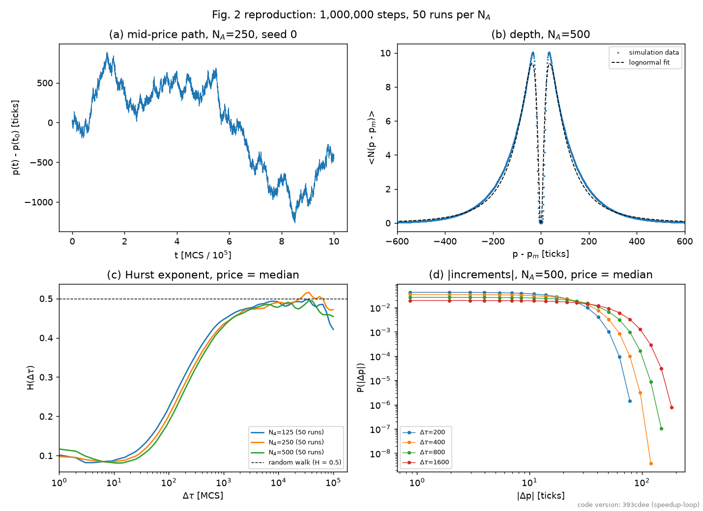
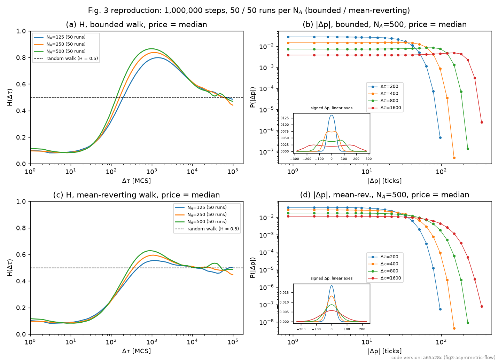
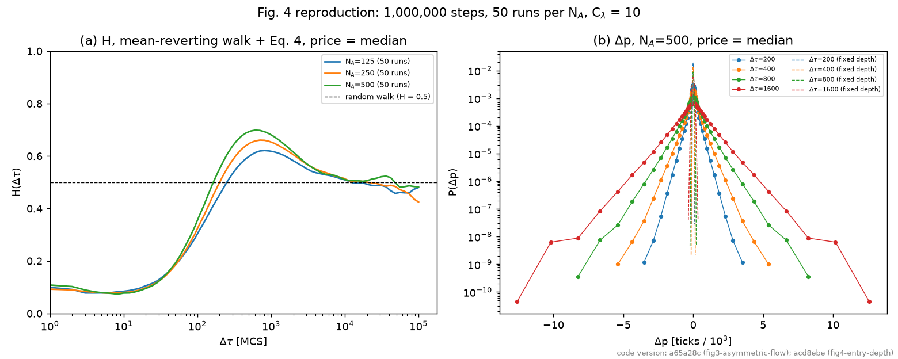

# HFT / Order-Book Agent-Based Model

An agent-based model of a limit order book, built on Preis, Golke, Paul & Schneider (2006),
"Multi-agent-based Order Book Model of financial markets", *EPL* 75, 510. The paper is first
reproduced as a validated baseline. The baseline is then used to study how a market recovers after
a flash crash or flash rally, and the model is tested against real order book data.

## Status

- **Phase 1 (done):** Figs. 2, 3 and 4 of the paper reproduced at paper scale (10⁶ steps, 50 runs
  per N_A). See [Results](#results). This version is tagged `baseline-v1`.
- **Phase 2 (in progress):** recovery after a large order. Done so far: a shock test, orders
  bigger than one unit, agents with different speeds and order sizes, and value traders, which make
  the price recover. Next: tune the value traders, then set the model's parameters from E-mini
  futures data and compare the model with it. See [docs/phase2_plan.md](docs/phase2_plan.md).

Status and next steps are in [docs/project_plan.md](docs/project_plan.md). The reasoning behind
each modelling and measurement choice is in [docs/decisions.md](docs/decisions.md). What the paper
itself defines is summarised in [docs/paper_model.md](docs/paper_model.md), and the checks and
comparison with the paper are in [docs/validation.md](docs/validation.md).

## Results

The paper does not say which price it uses. The median trade price in each step is used here,
because it matches the paper's Fig. 2c best ([decisions.md](docs/decisions.md), D11).

**Fig. 2: basic model.** At long time lags the price moves like a random walk (Hurst exponent
H → 0.5). At short lags it is anti-persistent, with H down to about 0.08 near Δτ ≈ 10. The order
book depth has a lognormal-like shape, and price changes have no fat tails. All as in the paper.



**Fig. 3: trends in order flow.** The takers' buy probability follows a random walk. This pushes H
above 0.5 near Δτ ≈ 10³: up to 0.87 for the bounded walk (paper: up to 0.9) and 0.63 for the
mean-reverting walk. The bounded walk gives two-peaked price-change distributions, as in the paper.



**Fig. 4: fat tails.** Linking order placement depth to the trend (the paper's Eq. 4) gives fat,
exponential tails (straight lines on the semi-log plot). Without it they are close to Gaussian (dashed
lines). The tail widths match the paper's Fig. 4b to within reading error: for example, at
Δτ = 200 the curve reaches 10⁻⁷ at about 2,200 ticks (paper: 2,000–2,500).



## Layout

| Folder | Contents |
|---|---|
| `abm/` | The model: `orderbook.py` (matching engine), `agents.py` (liquidity providers / takers, agent types with different speeds and order sizes, value traders, which react to the price, and momentum traders, which follow the trend), `buy_probability.py` (how the takers' buy probability changes over time, Figs. 3 and 4), `simulation.py` (step loop, runs agents through orderbook) |
| `analysis/` | Measurements on one simulation's output: `prices.py` (price series), `hurst.py` (Hurst exponent), `returns.py` (return distributions), `depth_profile.py` (depth profile + lognormal fit), `recovery.py` (how far a shock moves the book and how much is undone), `autocorr.py` (autocorrelation of price changes and of their size, i.e. volatility clustering) |
| `experiments/` | Reproducing the paper's figures: `run.py` (runs many simulations and saves the results), `plot.py` (draws Fig. 2, 3 or 4 from saved results, or compares several results files); `checkpoint.py` and `provenance.py` are support code these two use, not called directly. `shock.py` is the shock test: one large market order, then the book is watched as it refills |
| `tests/` | One test file per file above |
| `docs/` | `project_plan.md` (status and next steps), `paper_model.md` (the model as the paper defines it), `decisions.md` (assumptions and choices made where the paper is unclear, to note in the thesis), `validation.md` (the tests and numbers behind them, and the comparison with the paper), `phase2_plan.md` (draft plan for the flash-crash work), `figures/` (the final plots shown above) |
| `results/` | Generated data and plots (not tracked by git) |

## Pipeline of results

```
abm/simulation.py        runs ONE simulation -> a SimulationResult
        |
        v
analysis/*.py             turns a SimulationResult into numbers
  prices.py                  price series (mid, or a trade price)
  hurst.py                   Hurst exponent, from RMS price changes
  returns.py                 return-distribution histograms
  depth_profile.py           depth profile + its lognormal fit
  recovery.py                response to a shock: impact, share recovered, recovery time
  autocorr.py                autocorrelation of price changes, and of their size
        |
        v
experiments/run.py        runs MANY simulations (parallel, resumable),
                           calls analysis/*.py on each, saves results/*.pkl
        |
        v
experiments/plot.py       reads saved .pkl files, draws a figure
```

Suggested reading order for the code: `abm/orderbook.py` first (what one order book does), then
`abm/agents.py`, `abm/buy_probability.py` and `abm/simulation.py` (what runs on top of it), then whichever
`analysis/*.py` file matches the quantity of interest. `experiments/` only
orchestrates those pieces at scale — there is no separate model logic there.

## Running things

Run every command from the project root, using `python -m` so the imports resolve.

All tests at once (about a minute):

```
python -m pytest tests -q
```

Or one test file at a time, printing PASS/FAIL per check, e.g. `python -m tests.test_orderbook`.

A single simulation with the paper's Fig. 2 parameters (short run):

```
python -m abm.simulation
```

### Reproducing the figures

`experiments.run` runs one experiment: 50 independent runs for each of N_A = 125, 250, 500, spread
over CPU cores. `--flow` chooses how the takers' buy probability behaves: `symmetric` (constant ½,
Fig. 2; the default), `bounded` or `mean-reverting` (the two random walks of Fig. 3).
`--depth-coupling 10` adds the volatility-coupled entry depth of Eq. 4 (Fig. 4; mean-reverting flow
only). Each setting is a separate experiment with its own results file. The paper-scale default (10⁶ steps, 50 runs per N_A)
takes about 5–6 hours per flow on a 4-core laptop, so a small trial first is advisable:

```
python -m experiments.run --n-steps 100000 --n-runs 4 --out results/fig2_trial.pkl
python -m experiments.plot fig2 --data results/fig2_trial.pkl --out results/fig2_trial.png
```

Fig. 3 needs both random-walk experiments:

```
python -m experiments.run --flow bounded --out results/fig3_bounded.pkl
python -m experiments.run --flow mean-reverting --out results/fig3_mean_reverting.pkl
python -m experiments.plot fig3 --bounded results/fig3_bounded.pkl --mean-reverting results/fig3_mean_reverting.pkl --out results/fig3.png
```

Fig. 4 needs one more experiment; `--compare` adds the Fig. 3 mean-reverting results (fixed entry
depth) to the distribution panel as dashed lines:

```
python -m experiments.run --flow mean-reverting --depth-coupling 10 --out results/fig4.pkl
python -m experiments.plot fig4 --data results/fig4.pkl --compare results/fig3_mean_reverting.pkl --out results/fig4.png
```

The paper does not say which "price" it uses, so each run stores results for five definitions
(`mid`, `last`, `first`, `median`, `mean`). The plots use the median trade price by default
(`docs/decisions.md`, D11); `--price mid` etc. selects another. `plot fig2` also saves a second
figure (`..._price_definitions.png`) comparing all five.

Each run is saved as soon as it finishes (in `<name>.pkl.parts/`), so an interruption
(sleep, crash, power cut) loses at most the runs in progress. To continue, repeat the same
command with `--resume`; already-saved runs are skipped. `--resume` also extends a finished
experiment: run 10 seeds now, then rerun with `--n-runs 50 --resume` to add the other 40. It
refuses if the settings, the flow, the entry depth or the code version differ from the saved runs
(`--allow-code-change` overrides the code check when the change is known not to affect the
simulation). If a run fails or the experiment is stopped with Ctrl+C, the runs still queued are
cancelled at once rather than run to completion.

### Comparing versions of the model

`--value-fraction` turns a share of the takers into value traders (see the shock test below). To see
what that does to the price in normal times, run the same experiment with and without them, then
put the results side by side:

```
python -m experiments.run --n-steps 100000 --n-runs 8 --out results/plain.pkl
python -m experiments.run --n-steps 100000 --n-runs 8 --value-fraction 0.2 --out results/value20.pkl
python -m experiments.plot compare --data results/plain.pkl results/value20.pkl --labels "none" "20%" --out results/compare.png
```

The comparison shows the Hurst exponent, one return distribution, and the autocorrelation of price
changes and of their size (volatility clustering), all for N_A = 500, and prints a table of the
main numbers. It works for any results files, e.g. with `--flow` or `--depth-coupling` as well.

`--provider-types` and `--taker-types` give the agents different speeds and order sizes: each K is a type
that gets a chance every K steps and places orders of K units, and the agents are split equally between
the types listed. For example, every taker placing 4-unit orders every 4 steps:

```
python -m experiments.run --n-steps 100000 --n-runs 8 --agent-counts 500 --taker-types 4 --out results/types_takers4.pkl
```

### Shock test

Injects one large market sell order into the basic model after the book has settled, and records the
price, the spread and the number of orders on each side afterwards, averaged over many runs. Size 0
is the control with no shock. It takes about 15 minutes on a 4-core laptop at these settings:

```
python -m experiments.shock --sizes 0 50 150 300 --n-runs 400 --out results/shock_test.png
```

`--buy` injects a buy order instead. A summary table is printed, and the averaged curves are saved
next to the figure as a `.pkl` file.

`--provider-mix` and `--taker-mix` give the agents different speeds and order sizes. Each item is
`K:COUNT`: that many agents which get a chance to act every K steps and place orders of K units, so
every type trades the same volume on average. The counts must add up to 250:

```
python -m experiments.shock --provider-mix 4:250 --out results/shock_providers4.png
python -m experiments.shock --provider-mix 1:100 2:100 4:50 --out results/shock_mixed.png
```

`--momentum-traders N` turns N of the takers into momentum traders, which follow the trend of the last
`--momentum-window` mid-prices (50 by default); `--momentum-orders 1 2 3` says how many derivatives of
the price they see. The runner has the same options as `--momentum-fraction` etc. (see
`docs/decisions.md`, D31).

`--value-traders N` turns N of the 250 takers into value traders. Each has its own estimate of the
asset's true value (plus or minus a personal error), buys when the price is below it and sells when
above. The true value moves by a small random step every step. With value traders the price recovers
after a shock:

```
python -m experiments.shock --value-traders 125 --out results/shock_value125.png
```

`--news-chance P` adds news: each step there is a chance P that the true value jumps, by a random size
around `--news-jump` ticks (30 by default), up or down. It needs value traders. The runner has the same
options, and stores the time and size of every jump (`docs/decisions.md`, D32):

```
python -m experiments.run --n-steps 100000 --n-runs 8 --value-fraction 0.2 --news-chance 0.0001 --out results/news.pkl
```

### News event study

Long runs with news, then the price around every jump is lined up and averaged: how fast the price
takes in the news, and whether it overshoots (`docs/decisions.md`, D33). It takes the same agent
options as the shock test. Each `run` saves one market; `plot` draws several together:

```
python -m experiments.news run --value-traders 50 --out results/news/value50.pkl
python -m experiments.news run --value-traders 50 --momentum-traders 50 --out results/news/value50_mom50.pkl
python -m experiments.news plot --data results/news/value50.pkl results/news/value50_mom50.pkl --labels "value" "value + momentum" --out results/news/compare.png
```

### Poisson trader event study

`--poisson-chance P` (runner) adds the Poisson trader: with chance P each step it places one market
order, `--poisson-rate` units per step since its last order (0.03 by default, so 300 units on average
at P = 0.0001), buy or sell at random (`docs/decisions.md`, D34). The event study lines up every
order in long runs, like the news study, and averages the price in bands of order size. It also
plots each order's impact against its size (D35):

```
python -m experiments.pressure run --value-traders 50 --out results/pressure/value50.pkl
python -m experiments.pressure plot --data results/pressure/plain.pkl results/pressure/value50.pkl --labels "paper's agents" "value 50" --out results/pressure/compare.png
```

### Value trader sweep

Tries 48 combinations of value trader settings (share of takers, amount of news, mean error), plus a control
with none. Each combination gets a shock test and a long run without a shock, so that recovery speed
can be set against how market-like the price is in normal times (`experiments/value_sweep.py`):

```
python -m experiments.value_sweep list                     # the combinations, numbered 0 to 48
python -m experiments.value_sweep run --index 7 --workers 8
python -m experiments.value_sweep collect                  # table + figure, results/value_sweep/
```

At the default size it is meant for a cluster: one combination per job (see below).

### Momentum trader sweep

Tries 240 combinations of momentum trader settings: their share of the takers (10%, 25%, 50%), the
mix of orders (only 1, 2 or 3, a third of each, or two thirds of one and a third of another), the
window (50, 100, 200, 500 steps), each with and without 20% value traders, plus two controls
(`experiments/momentum_sweep.py`). It works like the value trader sweep, with its own job script:

```
python -m experiments.momentum_sweep list
sbatch --cpus-per-task=16 --time=01:00:00 cluster/momentum_sweep.slurm
python -m experiments.momentum_sweep collect
```

`collect` prints a table and draws heatmaps (`results/momentum_sweep/summary_*.png`) of the typical
price move, the Hurst exponent, the lowest price after a shock, the recovery half-life and the
kurtosis, one panel per window.

### Running on a cluster (Slurm)

Once, on the cluster:

```
git clone https://github.com/alex-hewson/ABM-Project.git
cd ABM-Project
python3 --version
python3 -m venv ~/abm-env
source ~/abm-env/bin/activate
pip install numpy matplotlib pytest
python -m pytest tests -q
mkdir -p logs
```

`python3 --version` must show 3.12 or newer; if not, look for a newer Python with `module avail`.
One test compares a run against exact numbers recorded on the laptop; on a different Python version
it can fail without anything being wrong. The other tests should all pass.

To run the value trader sweep, switch the Python environment on, go to the project folder, check
the settings at the top of `cluster/value_sweep.slurm`, then:

```
git pull
sbatch --cpus-per-task=16 cluster/value_sweep.slurm
squeue -u $USER
```

The jobs use the Python environment that was switched on when they were submitted.

Use `sbatch`, not `srun`. On this cluster an interactive `srun` hangs without printing anything,
because its output cannot get back to the login node. A quick test can be run as a batch job
instead, e.g. `sbatch --partition=cpu --wrap="python --version"`, and its output read from the
`slurm-<number>.out` file it leaves in the current folder.

Each job writes its progress to `logs/value_sweep_<number>.out`. When they have finished, copy the
results to the laptop (run this on the laptop, from the project folder) and collect them:

```
scp -r <username>@<cluster address>:ABM-Project/results/value_sweep results/
python -m experiments.value_sweep collect
```

Always give experiments `--workers` on a cluster: without it they use every CPU on the machine, not
just the ones the job was given.

## Requirements

Python 3.12+ (the fast simulation method uses `random.binomialvariate`) with `numpy`, `matplotlib`
and `pytest`.

Note for PowerShell: do not pipe the runner's output through `Select-Object -First N`. That closes
the output after N lines, which stops the runner at its next progress message.
